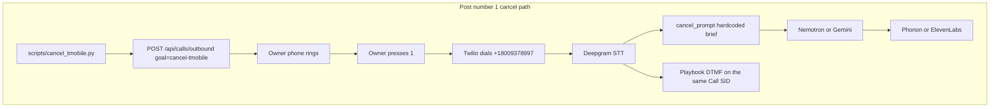
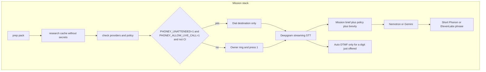

# Phone missions

A mission is a JSON pack plus a curated research file. Phoney still owns Twilio,
Deepgram, and the audio path. A coding-agent CLI owns preparation. The default
commands do not dial.

```sh
python -m phoney_missions prep tmobile-cancel
python -m phoney_missions research tmobile-cancel
python -m phoney_missions check tmobile-cancel
python -m phoney_missions report tmobile-cancel
PHONEY_ALLOW_LIVE_CALL=1 python -m phoney_missions place-call tmobile-cancel
```

Artificial call, no Twilio dial. On the Mac:

```sh
pytest tests/test_cancel_call.py::test_artificial_cancel_and_retention_calls -q
python scripts/mission_run.py run tmobile-cancel --simulate
python -m phoney_missions run tmobile-cancel --simulate
```

`--simulate` feeds scripted remote utterances through a Deepgram-shaped final,
mock Nemotron, and mock Phonon, and records DTMF on a fake dialer. Covered
forks in `docs/missions/tmobile-cancel/CONVERSATION_TREE.md` are canned and do
not call the model. Each edge cites `docs/missions/tmobile-cancel/SOURCES.md`.
Extra scenarios include `pin-missing`, `supervisor`, `cheaper-plan`,
`unpair-watch`, `downgrade-trick`, `eip-blocks`, `no-callback`, and `ivr-route`.

`scripts/mission_run.py` is the same CLI. `run` prepares, refreshes the local
research cache, prints the plan, and dials only when `PHONEY_ALLOW_LIVE_CALL=1`
is set on a loopback Phoney outside CI.

## Current call stack and target mission stack





T-Mobile cancel is the pack `phoney_missions/packs/tmobile-cancel.json`. The
same schema is the template at `phoney_missions/templates/mission.json`.

## What the CLI owns and what Phoney owns

| Step | Owner | Does not |
| --- | --- | --- |
| `prep`, `research`, `check`, `report` | Mission CLI | Dial, read PIN or SSN into a file |
| `place-call` | Mission CLI posts to loopback `/api/calls/outbound` | Talk to Twilio itself |
| Allowlist, Call SID, media streams | Phoney | Invent a destination |
| STT, LLM, TTS, barge-in, `<Play digits>` | Phoney | Skip the allowlist |
| Owner press 1 | Phoney, unless both unattended flags are set for a mission | Apply to ordinary calls |

`place-call` sends `{"to": "<pack e164>", "goal": "mission:<id>"}`. The server
loads the pack. A client cannot set unattended in JSON. The server skips the
owner gate only when the goal is a mission, `PHONEY_UNATTENDED` and
`PHONEY_ALLOW_LIVE_CALL` are both `1`, and `CI` / `GITHUB_ACTIONS` are unset.

## Safety flags

| Flag | Effect |
| --- | --- |
| unset | Owner phone rings. Press 1 before the destination is dialed. |
| `PHONEY_ALLOW_LIVE_CALL=1` alone | CLI may post a loopback dial. Owner press 1 still required. |
| `PHONEY_UNATTENDED=1` alone | Ignored. Press 1 still required. |
| both `=1`, not CI | Mission dials the destination without ringing the owner. This is the T-Mobile live recipe. The caller speaks as the account holder. `check` and `place-call` refuse if the pack's required PIN or SSN last four is missing. |
| `CI` or `GITHUB_ACTIONS` | CLI refuses. Server keeps press 1 even if both flags are set. |

Non-mission calls always ring the owner. Unattended missions use the two-leg
relay, not the native conference pilot. Do not set these flags in a cloud agent.

PIN and SSN last four stay in `CANCEL_ACCOUNT_PIN` and `CANCEL_SSN_LAST4`.
They are copied into the live runtime instruction only. They are not stored on
the agent snapshot, not written by `research`, and not printed by `check`.
Passwords are rejected by the schema and are never loaded.

## Brevity

Every shipped mission and the generic template set `"brevity": "strict"`.
The brief always appends: no filler, no empathy padding, do not restate the
question, do not ramble, and prefer DTMF when a menu digit works. One spoken
turn is one short sentence. A confirmation of a number or a date may use a
second short sentence. Sample lines that exceed that budget fail tests.

## Research

`docs/missions/tmobile-cancel/RESEARCH.md` cites the public pages. It is not
legal advice. `utterances.json` is the short line bank injected into the brief.
`research` copies that into `phoney_missions/cache/` and refuses to write a
configured PIN or SSN. X was not searched: the daily read limit was hit on
2026-10-28. Refresh after 2026-10-29 00:00 UTC.

## Retention policy

The pack holds `min_monthly_reduction_cents` and `min_months`. The prompt is
generated from those fields. A one-time credit is declined. A monthly credit
shorter than `min_months` is declined. A lasting reduction at or above the
threshold may be accepted instead of cancel. The default is $20.00 for at
least 12 months. Community reports of $10 for 6 months are below that default.

## IVR

Auto DTMF runs only when the recording just said "press N" for a representative,
or an override entry sets `digits` and `auto`. Cancel-line phrases are
model-only. A transcript that would cancel every line or the whole account
sends no digits. Digits are not logged; the count is. A failed Twilio update
is not retried.

## Extension points

1. Add `phoney_missions/packs/<id>.json` with `goal_key` `mission:<id>`,
   `brevity` `strict`, tools `speak`, `dtmf`, `hangup`, `note_confirmation`,
   and an allowlisted `destination.e164`.
2. Add a research markdown and an utterance bank. Keep secrets out.
3. Put the destination on `ALLOWED_DESTINATIONS`.
4. `python -m phoney_missions check <id>` before any live flag.

## Latency

See the audit. Deepgram is the only STT client. `scripts/measure_voice_latency.py`
prints budgets and the selected providers. It does not dial.

## Gaps after this change

- Phonon still returns a full HTTP body before the first audio chunk.
- The model can still emit a bad `[/DTMF]` line; only wipe phrases and the
  playbook auto-path are blocked in code.
- Unattended mode does not use the native conference pilot.
- No live web fetch and no X refresh until after 2026-10-29 00:00 UTC.
- Confirmation parsing in the simulator is for tests. The live model records
  `[/NOTE ...]` itself.
- This repository cannot see the Mac `.env`. `check` on that Mac reports
  whether Deepgram is configured without printing the key.
